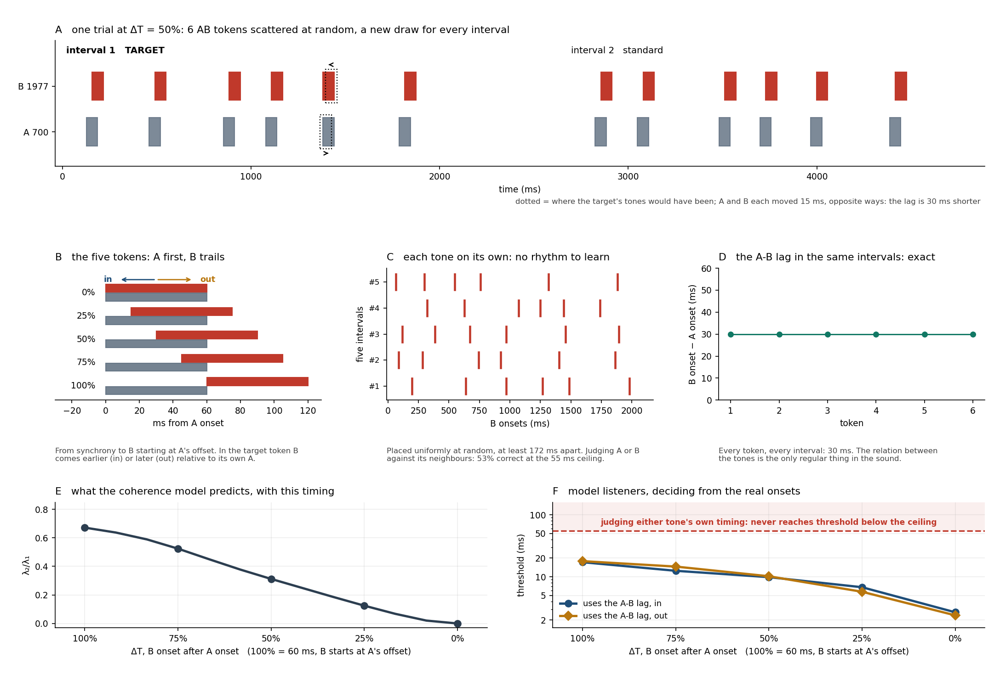
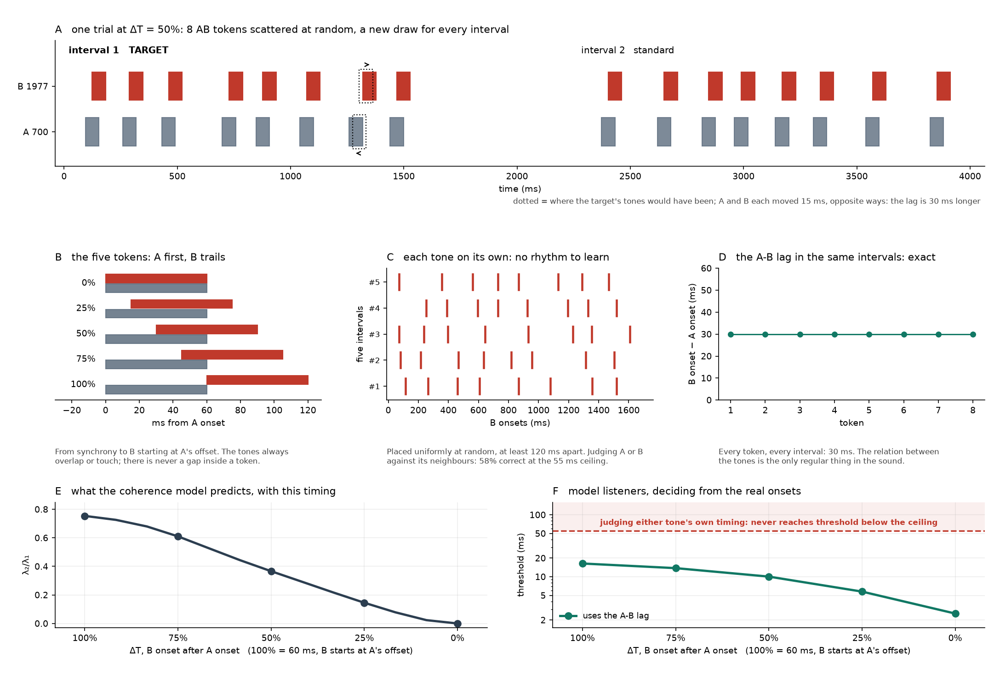
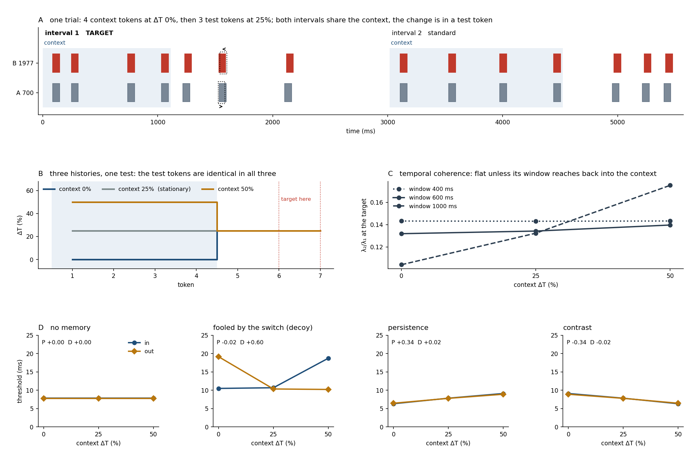

# tpair: the A-B relation, with nothing else to go on

Elhilali et al. (2009), Figure 8, behaviourally. Six AB tokens; A comes first and B starts ΔT
after it, from 0% (synchronous) to 100% (B starts at A's offset). In one of two intervals the
lag of the last or second-to-last token changes by δ: B comes earlier relative to its own A
("in") or later ("out"). The listener says which interval, and δ is tracked to threshold at each
ΔT and direction.

```bash
python -m tpair verify
python -m tpair design --config tpair/configs/tpair_scatter_feasibility.json
python -m tpair demo   --config tpair/configs/tpair_scatter_feasibility.json --out demo/tpair_scatter
python -m tpair run    --config tpair/configs/tpair_scatter_feasibility.json --data data --code L01
python -m tpair analyze data/L01/tpair_session_03
```

The current preset is `tpair_fast_out` (5 Hz, out only): see [Fast mode](#fast-mode-5-hz-out-only-tpair_fast_out).



## The cue this version removes

Whatever moves to change the lag also moves against the other tokens. A listener who ignores
the A-B relation and only hears "that tone was off the rhythm" can do the task, and that
strategy has nothing to do with grouping.

L01's second session, run on the earlier design (tokens jittered ±35 ms around a 3 Hz grid, B
moving alone), shows it. The answers followed B's own irregularity (strategy check z = +2.55,
p = 0.011). A near-ideal listener using only that cue needs 36.6 ms, and B alone measured
37.8 ms. Thresholds at 25–100% were only 1.3–1.8× better than B alone.

Two changes close it.

**Tokens are scattered, not jittered.** The six tokens are placed uniformly at random in a fixed
window, subject only to a minimum onset-to-onset gap. The joint density of the onsets is then
flat. Moving a tone leaves the sequence exactly as probable as it was, unless the move takes it
closer to a neighbour than the minimum gap. So there is no grid to fit, no rhythm to learn, and
nothing to predict one tone's timing from. Among all densities on a given range, the flat one
leaves the least for an ideal listener to exploit: what a shift reveals is the density's total
variation along it, and that is smallest when the density is constant. The commonest gap is the
minimum itself, so a short gap is never suspicious.

**The change is split.** The lag changes by δ, but A moves δ/2 one way and B δ/2 the other. The
token stays centred, and each tone moves only half as far against its neighbours as the
relation changes.

| at the 55 ms ceiling | old design | this design |
|---|---|---|
| judging B against its own neighbours | 79.4% point at ~37 ms | **52%** correct |
| watching A and B each for a hiccup | n/a (A never moved) | **52–53%** |
| ideal observer: perfect timing, knows the minimum gap to the ms | n/a | **60%** |
| using the A-B lag | 2–22 ms | **2.5–18 ms** |

The staircase needs 79.4%. No route through a tone's own timing gets there.

## Parameters

| | |
|---|---|
| tones | A 700 Hz, B 1977 Hz: 18.0 st, 8.0 ERB, 5.9% from 3:1 and 8:3 (the midpoint between them); 60 ms, 5 ms ramps |
| ΔT | 0, 15, 30, 45, 60 ms = 0–100% of the tone |
| timing | onsets ≥ 172.5 ms apart (the least that keeps 25 ms of silence between tokens in every condition, with δ at its ceiling), ≤ 700 ms; gaps 329 ± 123 ms, **3.04 Hz** on average; a new draw for every interval |
| level | 65 dB SPL per tone; ±3 dB per interval and ±3 dB per token (both tones together) |
| interval | 2176 ms, the same in every condition; trial 4.85 s |
| δ | starts at 10 ms, ceiling 55 ms (an "in" change at ΔT 0% would open a gap inside the token at 60) |
| directions | in and out in separate blocks; ABBA over rounds; the opening direction alternates across sessions |

The per-token rove is there because a change of the lag changes how long A and B overlap, and
so the token's loudness, by about a dB. With the rove, "one token sounded fuller" is useless.

## The controls

**Decoupled probes** (10% of trials, never touching a staircase). A and B are scattered
*independently* and moved exactly as in a target token, at the ceiling. Each tone on its own
carries what it carries in the real trials, and the relation is gone. A listener should sit at
chance here. Every model listener does (51–55%). Every token threshold well below the ceiling,
alongside probes at chance, came through the relation. This replaces B alone.

**The strategy check.** Every tone's onset is logged. The analysis rebuilds how displaced A and
B each looked on their own in both intervals, and regresses the answers on that, beyond δ. A
listener using the relation shows nothing; a listener judging a tone's own timing shows it
plainly.

**Catch trials** (7%) sit at ΔT 0% with a 45 ms asynchrony. They are relational too, so a
listener ignoring the relation fails them, as well as one who has stopped listening.

Simulated sessions (`tpair_scatter_curve`, 20 tracks):

| | tracks with a threshold | trend with ΔT (in / out) | probes | strategy check z | catch |
|---|---|---|---|---|---|
| uses the A-B lag | 20/20 | p = 0.0001 / 0.001 | 53% | −0.0 to +0.9 | 100% |
| judges B's own timing | 0/20, all at the ceiling | none | 46% | B: +7.7 to +9.1 | 41% |
| judges A and B each | 0/20, all at the ceiling | none | 41% | A and B: +9 to +11 | 47% |

One session each, so the probe column carries sampling noise (90–180 probes). Over 20 000 trials
every tone-alone listener is at 51–52% on the probes in both directions.

## Reading the thresholds

- **A condition with a track at the ceiling has no geometric mean.** It is reported as a bound
  over all its tracks. A listener near chance can still walk a staircase down on a lucky run
  (2 tracks in 160 in simulation). Keeping only that track would report the luck.
- **Staircase and psychometric fit disagreeing by more than 2× is flagged.** In L01's second
  session this marks ΔT 75%: the staircase said 10.6 ms, the fit to the same trials 23.8 ms. The
  dip there is probably a lucky track, not a property of the curve.
- **The axis runs 100% on the left, 0% on the right**, as in Fig. 8.

## Session length

| preset | tracks | trials | total |
|---|---|---|---|
| `tpair_scatter_feasibility` | 10 (5 in, 5 out) | 456 | 56 min |
| `tpair_scatter_curve` | 20 | 913 | 104 min, two sittings |

The feasibility preset runs each direction in one block. Direction is therefore confounded with
time in the session; only the curve preset's ABBA order balances it.

## Known limits

- **A rise with ΔT does not say how the relation was used.** Temporal coherence predicts it; so
  does any account in which a longer A-B lag is simply harder to time (Weber). The probes
  establish that the relation was used, not why it gets harder.
- **The ends of the axis carry their own cues.** At 0% any change is an onset asynchrony. At 100%
  "in" creates an overlap and "out" a gap; "out" at 100% is between-channel gap detection. "In"
  also puts B before A once δ exceeds the lag. Every trial records `passes_a_onset` and
  `opens_gap`, and the analysis reports both per condition.
- **In and out need not match.** Listeners time a high tone after a low one better than the
  reverse (Wojtczak et al. 2017, PNAS). An out/in difference is descriptive.
- **Irregular timing may weaken streaming itself.** The coherence model barely moves (0.68 at
  100%, against 0.73 for grid jitter), but listeners might. It applies equally at every ΔT.
- **The ceiling is 55 ms.** A listener who fully segregates the tones at 100% may sit at it. That
  would be a result, but a bound rather than a number.
- **Near the ceiling, "out" at 100% with two tokens at the minimum gap**, the target's B can sit
  closer to the next token's A than to its own. `pairing_preserved` records it.

## Fast mode: 5 Hz, out only (`tpair_fast_out`)

```bash
python -m tpair verify  --config tpair/configs/tpair_fast_out.json
python -m tpair jitters --config tpair/configs/tpair_fast_out.json --code L01 --session 7
python -m tpair run     --config tpair/configs/tpair_fast_out.json --data data --code L01
python -m tpair analyze data/L01/tpair_session_07
```



**Why.** Every tpair session so far ran at 3 Hz. The two-tone task that gave a clean rising curve
(tcoh, P01 session 2) ran at 6.7 Hz, as did Elhilali et al.'s psychophysics (100 ms tones, 50 ms
gaps). At 3 Hz the tokens are isolated events a third of a second apart, with little to stream.

**The tokens are session 05's**: A 700 Hz and B 1977 Hz, 60 ms, lags 0, 15, 30, 45, 60 ms, the
split change, ceiling 55 ms. Only the rate and the timing differ, so session 05 against this one
is the comparison that tests the rate.

**What had to change to get there.** Scatter timing kept whole tokens apart, which at 5 Hz leaves
no room for jitter. `clearance = "channel"` keeps apart only tones of the same pitch (25 ms of
silence) and keeps the tokens in order. Tokens may overlap, as in an ABAB sequence.

**Every interval is drawn from the seed and screened.** A draw that breaks a rule is thrown away
and redrawn from the same seeded stream, so a session stays exactly reproducible (replaying L01's
sessions 05 and 06 from their seeds gives every logged onset). The rules apply to the timing
before any change, in both intervals and every condition alike:

| rule | throws away | why |
|---|---|---|
| `max_ioi_ms` 400 | 18% of draws | a hole of more than twice the mean gap splits the sequence and restarts build-up |
| `regular_tol_ms` 12 | 4% | four tokens evenly spaced to 12 ms: a local grid that would make one moved tone stand out |
| `pair_clear_ms` 0 | 43% | at the largest lag, B starting nearer the NEXT token's A than its own |

About half of all draws are redrawn; what is kept is 201 +- 65 ms (120-400), 4.98 Hz.
`python -m tpair jitters` replays every planned slot of a session from its seed and reports
this, and the runner stores the same audit in `session.json` and refuses to start if any kept
interval breaks a rule.

A rule has an edge, and a change can carry the target across it where no standard ever goes. The
ideal observer knows every rule: it reaches 69.7% at the ceiling with them and 68.2% without
(6000 trials each). The screen costs about 1.5 points, all of it at the rules' edges.

**What a listener can use** (at the 55 ms ceiling, the largest lag):

| | 3 Hz scatter (session 05) | **5 Hz, this preset** |
|---|---|---|
| judging B against its neighbours | 51-53% | **56%** |
| watching A and B each for a hiccup | 52-53% | **59%** |
| ideal observer, perfect timing, knows every rule | 62% | **69.7%** (limit 70) |
| model l2/l1 at 100% | 0.67 | **0.76** |
| lag 100% as a share of the cycle | 18% | **30%** |

**Why the axis stops at the tone.** With jittered timing, once B starts after its own A has
ended it can be nearer the next token's A, and the coherence index turns over (75 ms tones at
5 Hz: 0.82 at lag 75, 0.76 at 100 = alternation). Up to the tone it rises under every reading of
the filter bank.

**Frequencies.** Elhilali et al. used A = 1000 Hz with B 6, 9 or 15 semitones above in the
psychophysics (synchronous thresholds 2-4 ms at all three), and 300 / 952 Hz (20 semitones) in the
Fig. 8 model. 18 semitones sits between the two. 15 semitones is 1.9% from 7:3, which the
harmonicity audit refuses; 14 is the nearest it accepts. By ISO 226, 700 and 1977 Hz at 65 dB SPL
are equally loud (64.7 and 64.8 phon): the 1-2 kHz region of the contour is flat enough. That is
an average ear and an ideal headphone. Calibration measures B only (1977 Hz); A's level at the ear
has not been checked.

**Verification:** 21 of 22 checks pass. The one that fails is the probes' lag spread: in a probe
the apparent A-B "lag" wanders by 77 ms within an interval, where the check asks for twice the
ceiling (110 ms). Model listeners on probes sit at 54-58%.

**Simulated sessions** (the real runner, no audio): the relational listener converges on 10/10
tracks (1.4, 4.6, 13.7, 15.9, 15.0 ms), catch 100%, strategy check z = -0.3 and +0.1. A listener
judging each tone's own timing fails the catch trials (62%), shows z = +8 to +11 in the strategy
check, and converges on 1 of 10 tracks by luck. Over 24 relational sessions of an earlier version
the strategy check fired on either tone in 12.5% of sessions, against about 10% expected: one
session's z of 2-3 is weak evidence.

**Session:** out only, 2 tracks per condition (10 tracks), 8 tokens with the target in the last
or second-to-last, practice at 25%, catch trials at 0% with 45 ms, probes on 10% of slots. 456
trials, about 48 minutes (worst case 94).

**Known limits.**
- **The comparison with tcoh is not only rate.** tcoh was isochronous, moved B alone, and used
  1000 Hz and 15 semitones. Against session 05 only the rate and the timing change.
- **At 100% every change opens a gap** between A's offset and B's onset (at 75%, once delta passes
  15 ms), so the top of the curve is partly between-channel gap detection, as before.
- **B is the higher tone.** Equal loudness does not make the two equally prominent; a listener may
  follow the high tone more readily. A always leads here, so that asymmetry is constant across lags.
- **Calibration.** The runner reports the amplitude that would give 65 dB but does not apply it.
  Sessions 05 and 06 ran at 55 and 60 dB. Set the system volume until `calibrate` reads 65.

## Older designs

`tpair_feasibility` and `tpair_curve` (grid jitter ±35 ms, 75 ms tones, 700/2262 Hz, B moving
alone, B alone as the control) are kept unchanged. Their hashes, condition names, trial order and
analysis are exactly as recorded, and `python -m tpair analyze` reads those sessions as before.
Sessions from either version are never pooled.

## Context mode: does binding persist?

```bash
python -m tpair verify --config tpair/configs/tpair_context_main.json
python -m tpair run    --config tpair/configs/tpair_context_main.json --data data --code L01
python -m tpair analyze data/L01/tpair_session_06
```



Every interval starts with 4 **context** tokens at one lag, then 3 **test** tokens at 25% (15 ms),
and the target is the 2nd or 3rd test token. The test part is physically identical in every
condition; only its history differs. Both intervals of a trial share the context, so the
switch never says which interval changed. Contexts are randomised trial by trial within a
block; directions are blocked, ABBA. Timing, the split change, the roves and the probes are the
scatter design above.

**Why these numbers, from L01's sessions.**
- Test at 25%. With the tones' own timing removed, 25% "in" (7.3 ms) was the last lag that
  still converged before everything from 50% up hit the ceiling. The steep part of the curve is
  where a change of binding state should move the threshold most.
- Contexts at 0% and 50%, the same 15 ms either side of the test. A context that is further
  away is a bigger change at the switch, so any "bigger change costs more" account would
  otherwise mimic persistence.
- Ceiling 70 ms, not 55. The largest lag is now 30 ms, which frees the room, and "out" at 25%
  had sat near 33 ms against the old ceiling.

**What each account predicts, and the three numbers that separate them** (log threshold units,
L- = 0%, L+ = 50%):

| | in | out | P | D | S |
|---|---|---|---|---|---|
| no memory of the context | flat | flat | 0 | 0 | 0 |
| persistence: the bound context helps | L- < stat < L+ | same | **+** | 0 | ~0 |
| contrast: the context repels | L- > stat > L+ | same | **−** | 0 | ~0 |
| decoy: the switch read as the change | L+ costs | L- costs | 0 | **+** | + |

- P = mean over directions of ln T(L+)/T(L-).
- D = half the in − out difference of the same quantity.
- S = the mean cost of both mismatched contexts against the stationary one.

The decoy is why **both directions are run**. The switch from 50% into the test *is* an "earlier"
change, in both intervals. A listener who listens for any change of the lag is fooled by it in
"in" blocks only. With "in" alone, that reads as persistence: model listener P = +0.62. With both
directions it is D = +0.61 and P = −0.01.

Model listeners on the real stimulus (`python -m tpair verify`):

| listener | P | D | S |
|---|---|---|---|
| no memory | +0.00 | +0.00 | +0.00 |
| fooled by the switch | −0.01 | +0.61 | +0.28 |
| persistence (500 ms decay) | +0.36 | +0.02 | −0.01 |
| contrast (500 ms decay) | −0.36 | −0.02 | −0.01 |

**Temporal coherence itself predicts almost no carry-over.** Over the 600 ms that end at the
target, λ₂/λ₁ is 0.132 / 0.134 / 0.140 across the three contexts. It is flat at 400 ms, and only
spreads (0.10 / 0.13 / 0.18) once the window reaches back into the context. A clear P in
listeners is therefore memory the published model does not have.

**Also reported:** accuracy against the time since the switch, per context (does the effect
fade within the trial?); and the previous trial's context, since prior-stimulus effects in
streaming outlast a trial (Snyder et al. 2008).

**Power.** One track's threshold varies by about 0.32 in log units, which bounds what one
listener can show. These figures are the chance of z ≥ 2, and they are optimistic: they ignore
differences between listeners.

| P | 1 listener, 2 tracks | 6 listeners, 2 tracks | 12 listeners, 2 tracks | 12 listeners, 3 tracks |
|---|---|---|---|---|
| 0.36 | 34% | 97% | 100% | 100% |
| 0.18 | 11% | 48% | 78% | 92% |

One listener shows a direction; the answer is a group result.

| preset | tracks | total |
|---|---|---|
| `tpair_context_feasibility` | 6 | about 40 min |
| `tpair_context_main` | 12 | about 75 min |

**Known limits of context mode.**
- An "in" change of more than 15 ms puts B before A (`passes_a_onset`). Below that it is a lag
  change, above it an order reversal, in every context alike.
- The decay estimate uses the scatter's natural spread of switch-to-target times (about
  0.2–1.5 s). It is exploratory, not a designed manipulation. The designed version varies the
  number of test tokens.
- Practice and catch trials use the stationary 25% condition, which is the judgement the task is
  about. The old practice at 0% taught a different, easier one.
