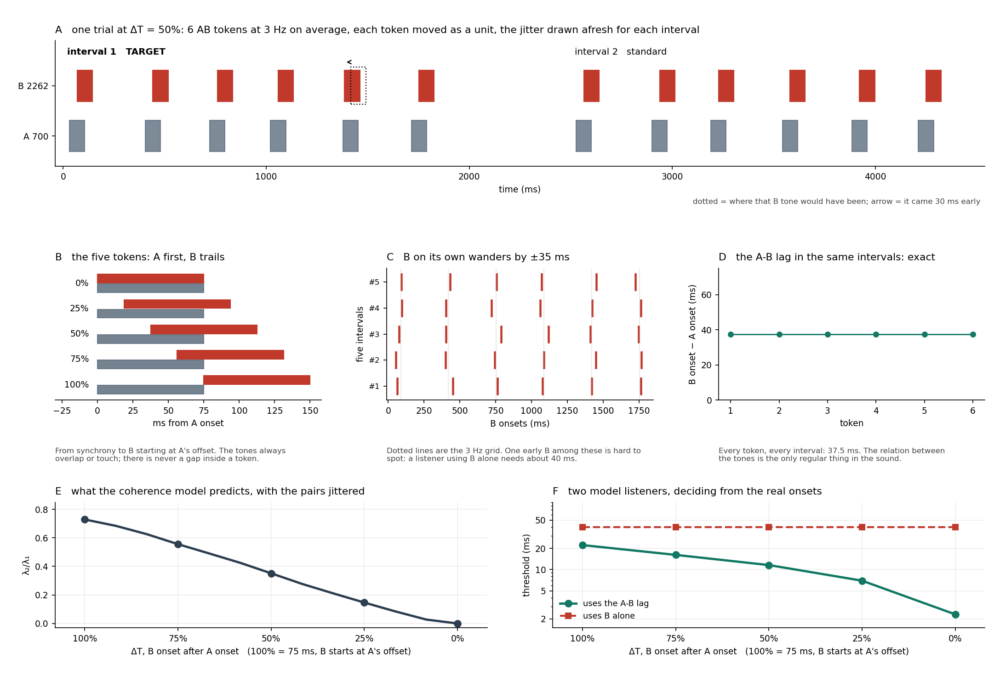

# tpair: jitter detection in irregular AB tokens

Elhilali et al. (2009), Figure 8, behaviourally, with one change: the tokens are jittered.

Six AB tokens fill a 2-second interval at an average of 3 Hz. A always comes first, like the
onset of a phoneme; B starts ΔT after it, from 0% (synchronous) to 100% (B starts exactly at A's
offset). Tones are 75 ms, as in their simulation. There is never a gap between A and B inside a
token. Each token is jittered as a whole, so ΔT is exact in every token while neither tone on
its own keeps a regular rhythm. In one of the two intervals, the B tone of the last or
second-to-last token comes early by δ. The listener says which interval, and δ is tracked to
threshold at each ΔT.

```bash
python -m tpair verify
python -m tpair run --config tpair/configs/tpair_feasibility.json --data data --code L01
python -m tpair analyze data/L01/tpair_session_02
```



## Conditions

| ΔT | lag | model λ₂/λ₁ (jittered) | Elhilali, continuous ABAB |
|---|---|---|---|
| 0% | 0 ms | 0.000 | 0.000 |
| 25% | 18.75 ms | 0.147 | 0.216 |
| 50% | 37.5 ms | 0.352 | 0.516 |
| 75% | 56.25 ms | 0.556 | 0.770 |
| 100% | 75 ms | 0.728 | 0.942 |
| B alone | | | |

The jitter lowers the index without changing its shape: the curve stays monotone under all five
readings of the filter bank. The curve is plotted as in Fig. 8, 100% on the left.

## Why the tokens are jittered

In a regular sequence a listener can judge the displaced B against B's own previous
repetitions and ignore A completely, a strategy blind to the thing the task manipulates. Here
each token moves by U(±35 ms) as a unit, so B on its own wanders by ±35 ms while ΔT stays exact.
The only consistent structure in the sound is the relation between the two tones.

Two model listeners, deciding from the actual onsets of each trial:

| ΔT | uses B alone | uses the A-B lag |
|---|---|---|
| 0% | 41 ms | 2.3 ms |
| 25% | 41 ms | 6.8 ms |
| 50% | 41 ms | 11.6 ms |
| 75% | 41 ms | 15.6 ms |
| 100% | 41 ms | 22.3 ms |

The B-only listener is flat because B's own distribution is the same at every ΔT. Below about
40 ms the answer has to come through A.

## Design decisions

**A first, B moves, and only early.** B moving early pulls it further into A. Moving it late
would open a silent gap inside the token at 100%, where B already starts at A's offset.

**Two ceilings.** In token conditions δ is capped at 70 ms. An early B could only leave its A
behind once δ exceeds ΔT + 75 ms, which is 75 ms at 0%, so 70 keeps every token gap-free;
`validate` refuses any config that breaks this. B alone has no A and no gap to open, and its
threshold sits near 40 ms by design, so it gets 120 ms: at a 100 ms ceiling, 3 of 4 simulated
B-alone tracks were censored.

**The jitter is drawn independently for each interval.** Sharing it would let B be compared
across the two intervals directly, which puts back the cue the jitter removes.

**The target is in token N or N-1, 50/50.** The listener cannot just wait for the last tone.
Performance by position is reported.

**700 and 2262 Hz.** 1.69 octaves, 9.2 ERB apart, 7.7% from 3:1 and from 7:2: the point above an
octave furthest from every ratio with terms up to 8.

## The controls

**B alone.** The same jitter and displacement with no A. It measures what a listener ignoring A
could do, and every ΔT is read against it.

**The strategy check.** Every trial's jitter is logged, so the analysis rebuilds how irregular B
looked on its own in each interval and asks whether the answers followed it once δ is accounted
for. A listener using A should not care. B-alone trials are the positive control.

**Ceiling-limited tracks are not dropped.** A listener ignoring A will push some token tracks to
the 70 ms ceiling. Dropping them would keep only the lucky tracks and make that listener look as
if A helped, so they are pooled as lower bounds and the "what A adds" ratio at that ΔT becomes an
upper bound.

Against simulated listeners, six sessions each (`tpair_curve`):

| | trend test p | what A adds, geometric mean over ΔT | strategy check z |
|---|---|---|---|
| uses the A-B lag | ≤ 0.008 in 6/6 | 3.6–8.8× | −1.2 to +1.9 |
| uses B alone | ≥ 0.26 in 6/6 | 0.97–1.32× | +7.7 to +8.1 |

## Session length

| preset | tracks | trials | total |
|---|---|---|---|
| `tpair_feasibility` | 6 | 257 | 32 min |
| `tpair_curve` | 12 | 514 | 58 min, two sittings |

A trial is 2.0 + 0.5 + 2.0 = 4.5 s of sound plus about 0.55 s of overhead. One track's 95%
interval spans about 3.6 times, so the feasibility preset says whether the task works, not what
the curve is.

## Known limits

* **A rise with ΔT does not by itself say how A was used.** Temporal coherence predicts it; so
  does any account in which a longer A-B lag is simply harder to time. The B-alone comparison
  establishes that A was used, not why it stops helping.
* **At 0%, any early B is an onset asynchrony.** That is the classic synchrony-detection cue and
  is the floor of the curve by design.
* **At 25-75%, a large δ carries B to A's onset and past it,** so B briefly leads. Every trial
  records this (`passes_a_onset`) and the analysis reports the fraction per ΔT.
* **The defence has a margin, not a guarantee.** The A-B listener at 100% needs 22 ms against
  the B-only listener's 41. If a real listener at 100% gets close to 40, the B-only route is
  competitive there; the strategy check reports it.
* **The model's ordering is robust; its heights are not.** All five readings agree the index
  rises with ΔT and disagree on height by up to 0.62.
* **Sessions recorded before this version** (100 ms tones, B first) carry `a_leads: false` in
  their stored config and are still analysed correctly, but are a different stimulus and are
  never pooled with these.
