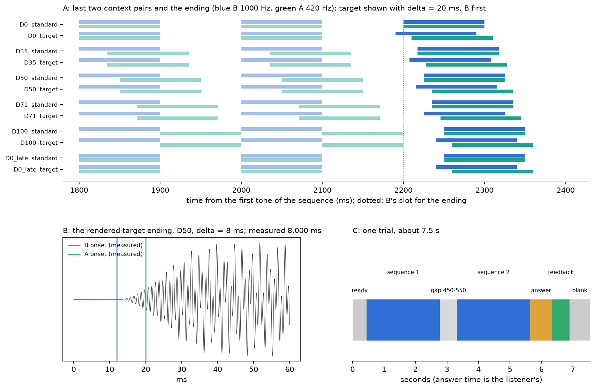
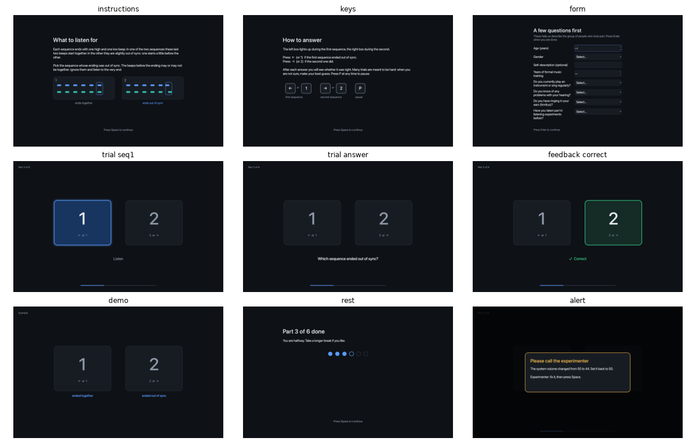

# tsync: sync detection at the end of two-tone sequences

**Does an onset delay between two tone streams stop listeners from comparing them?**

This is the grouping counterpart to Micheyl, Hanson, Demany, Shamma & Oxenham (2013, *JEP:HPP*
39:1568), Experiment 3. It uses their sequences exactly, and asks the opposite question. In
their task segregation helps: listeners must ignore A to hear a louder B. Here grouping helps:
listeners must compare A with B. Their performance rises with the A–B onset delay D; ours
should fall.



## The measure

| | |
|---|---|
| Tones | B 1000 Hz; A 15 semitones lower (420.45 Hz); 100 ms with 20-ms raised-cosine ramps |
| Rhythm | one tone every 200 ms per stream (5 Hz), 12 tones per stream |
| Context (pairs 1–11) | A starts D ms after B, D = 0, 35, 50, 71, 100 ms (Micheyl's Exp. 3) |
| Ending (pair 12), standard | A and B start together, midway between the two streams' slots (D/2 after B's) |
| Ending (pair 12), target | A and B start δ apart; δ split evenly (each tone moves δ/2), order (B first / A first) random |
| Control `D0_late` | in-sync context, ending 50 ms late: the same displacement as in D100, with no asynchronous context |
| Levels | B 60 dB SPL; A 60 dB SPL roved ±4 dB per tone, 1 or 2 A tones a further +4 dB (as Micheyl) |
| Presentation | both ears, same signal; 48 kHz, 32-bit float |
| Task | 2I-2AFC: which sequence ended out of sync? Feedback after every answer |
| Track | 3-down 1-up (79.4%), δ starts at 20 ms, steps ×4 → ×2 → ×√2, stops after 6 reversals at ×√2; threshold = geometric mean of those 6; δ range 0.25–60 ms |
| Catch trials | 2 per track at δ = 60 ms; they never move the track |
| Order | one track per condition; order from a 6×6 Williams Latin square (position and carry-over balanced); 12 listeners use each order twice |

**Why the ending is re-synchronised.** If the ending kept the context's lag, the listener would
have to tell D from D + δ. Telling two asynchronies apart gets harder the larger they are
(Weber's law), whatever happens to grouping. Here the judgement is "together vs δ apart" at
every D, so only the context changes.

**Why δ is split between A and B.** Each stream's last tone moves by only δ/2. A listener who
times one stream alone gets half the cue that the A–B relation carries, and that half-cue also
sits on the ending's D/2 displacement. Grouped listeners judge the A–B relation directly.

**Why D0_late.** At large D the ending sits off both rhythms (50 ms at D100). D0_late
displaces the ending just as much after an in-sync context. If D0_late ≈ D0, the rise with D
comes from the context, not from the displaced ending.

## A session

One visit of about 40 minutes:

| Part | Time |
|---|---|
| Questionnaire, instructions, sound check, two examples | about 4 min |
| Practice: 10 easy trials (criterion 8/10, up to 3 rounds), 6 trials in other contexts | about 2.5 min |
| 6 parts of about 5 min each, short rest between | about 33 min |

`python -m tsync design` prints the expected length from simulated listeners: median 40 min,
90% of sessions under 43 min.



**One trial.** Neutral screen 450 ms, then sequence 1 (left box lit), 450–550 ms of silence
(roved, so its length is never a cue), then sequence 2 (right box lit). Then the answer: ← or
1 for the first, → or 2 for the second. Feedback shows a symbol and a word for 550 ms, then a
650 ms blank. Between trials there are at least 1.65 s of silence plus the answer time, more
than three times the gap inside a trial, so the two sequences of one trial are never confused
with the next.

**Keys.**
- ← / 1, → / 2: answer (keypad works too; on macOS keys are read by physical position, so a
  Persian keyboard layout cannot break them).
- P: pause at any time. A trial in progress is stopped and run again later with fresh random
  numbers.
- Esc: experimenter menu (Q saves and quits).

## Running it

```bash
python -m tsync verify                  # every check that needs no listener (about 30 s)
python -m tsync calibrate               # sound level meter + coupler, both tone frequencies
python -m tsync check-audio             # silent: latency, dropouts, scheduling accuracy
python -m tsync run --code P01          # a session (experimenter checklist, then full screen)
python -m tsync analyze data/P01/tsync_session_01
python -m tsync group data/P*/tsync_session_01 --out group
python -m tsync audit data/P01/tsync_session_01   # rebuild every trial, compare SHA-256
```

`run --resume` continues a session that was interrupted. A trial cut short by a crash is run
again, and each track is rebuilt exactly from the logged answers. `run --uncalibrated` is for
piloting only; the session is flagged.

Others: `design`, `preview` (every screen as PNG), `demo` (example trials as WAV),
`simulate` (simulated listeners through the whole session).

The app needs PySide6 (`pip install PySide6-Essentials`). Everything else uses the repo's
dependencies.

## What is recorded

Each session gets its own folder, `data/<code>/tsync_session_NN/`. Every line is written to
disk (fsync) the moment it happens.

- **`session.json`**:
  - who and when: participant answers (age, gender, years of music training, current playing,
    hearing problems, tinnitus, prior experiments), debrief, experimenter, checklist;
  - what ran: configuration and its hash, the plan (order, catch slots, session seed),
    calibration, git commit, SHA-256 of the package source;
  - where: package versions, machine, display, audio device and stream;
  - volume: the system volume at the start and the locked value;
  - outcome: per-track audits and the final status.
- **`trials.csv` / `trials.jsonl`**: one row per presented trial, including examples, practice,
  catch trials and aborted trials.
  - The trial: condition, δ, order, which interval, answer, key, response time (from the true
    end of sequence 2), early key presses.
  - The track: staircase step, reversal, next δ.
  - The sound: the asynchrony in each interval, the silent gap, the seed, the buffer's SHA-256
    and peak, onset timing error (actual vs scheduled DAC time), dropouts, longest audio
    callback gap, visual cue lag.
  - The machine: system volume, mute, alert volume and device for that trial.
  - The JSONL rows also list every tone: onset, level, rove, decoy, phase and amplitude.
- **`events.jsonl`**: screens, keys outside trials, pauses, alerts, repeated trials, track
  summaries.
- **`code.patch`**: uncommitted changes to the package, if any.
- **`summary.json`, `thresholds.csv`, `summary.png`**: written by `analyze`.

## Safeguards

- **Output device.** Sound plays only through a device whose name contains "Headphones" (the
  Mac's headphone jack), never through the speakers.
- **Volume.** The system volume is locked at the session's starting value and checked before
  every trial. If it changes, or the output is muted, or the audio stream stalls (headphones
  unplugged), the trial is not played and an alert calls the experimenter.
- **One stream.** A single audio stream stays open for the whole session, and each trial is
  scheduled on its sample clock. Each trial is one buffer, so timing inside it is exact. A
  trial with a dropout or a late start is logged and repeated.
- **Calibration.** A calibration records device, system volume, headphones, meter and coupler,
  and a session refuses to run if the device or volume differs. Each tone frequency is
  calibrated separately; use Z or C weighting, because A weighting is −3 dB at 420 Hz.
- **Checks without a listener.** `verify` measures the asynchrony from the rendered waveform:
  it matches δ to under 1 µs. It also checks levels, randomisation, the ordering design, the
  staircase (recovers known thresholds) and a whole simulated session.
- **Tests.** `tests/test_tsync.py` includes a robot participant that drives the real app
  offscreen through a full session, with pauses and the experimenter menu.

## Analysis

- **Threshold per condition.** The published reversal rule, replayed from the logged answers
  and checked against what was logged live.
- **Fitted threshold.** A maximum-likelihood psychometric fit to every staircase trial
  (cumulative Gaussian on log δ, guess 0.5, lapse 0.02), with a parametric-bootstrap 95%
  interval.
- **Grouping index.** g(D) = (log θ(D100) − log θ(D)) / (log θ(D100) − log θ(D0)), which runs
  from 1 to 0. It is scaled the same way as Micheyl's d′ in the group figure.
- **Control.** D0_late vs D0, in octaves.
- **Flags.** Unconverged tracks, ceiling or floor trials inside the averaged reversals, catch
  accuracy below 75%, failed practice, volume changes, underflows, uncalibrated levels.
